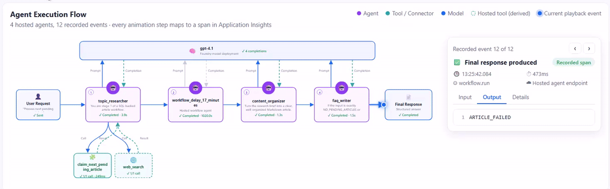

# Agent Dashboard

A local-first, read-only **trace replay** dashboard for Microsoft Foundry hosted agents. A Node.js backend serves a vanilla JavaScript frontend, with UI configuration and Docker packaging. Runtime data comes from your Application Insights telemetry; missing data is reported rather than simulated.

**Agents & Workflow** and **Solution Workspaces** are disabled for now, including their deep links. Their implementation and APIs are retained, but the current UI focuses on Trace Playback. This is an independent project, not a Microsoft-sponsored product.

To generate real traces, use the [three-agent article workflow example](examples/article-workflow/README.md). It includes opt-in provisioning and Foundry deployment scripts, SQL article claiming, web research, private Blob output, and Application Insights instrumentation. Nothing is provisioned by starting the dashboard.

Start with [Getting started](docs/getting-started.md), [Distributed workspaces](docs/distributed-workspaces.md) and [Privacy](docs/privacy.md).

## Trace replay demo



[Watch or download the screen recording (MP4)](docs/assets/trace-replay.mp4). This demonstrates playback of recorded traces, not a new agent invocation. The recording includes an earlier workflow configuration; the current example has no artificial delay.

## Run

Install Node.js 22+ and [Azure CLI](https://learn.microsoft.com/cli/azure/install-azure-cli).

```powershell
npm start
```

Open http://localhost:3000. 

1. Open **Settings → Sign in to Azure**, click **Copy code**, follow the Microsoft device-login link, and paste the code. If clipboard permission is unavailable, select the readonly code field and copy manually. This uses Azure CLI, not OIDC. Alternatively run `az login` where the backend runs; an existing CLI login also works.
2. Refresh the project list, select a Foundry project, and optionally override its Application Insights App ID.
3. Set a default agent and time window in Settings. Project selection, App ID overrides, and defaults are saved in `data/config.json` and survive restarts. Existing settings are preserved; legacy local account/password hashes are removed automatically on startup.
4. Open **Trace Playback**, select a recorded trace, and press Play. Run-history rows also open replay; replay never invokes an agent.

Device-code login may be blocked by your organization's Conditional Access policy; use an approved Azure CLI sign-in method instead. Project listing requires Azure Resource Graph/ARM read access; viewing agents and telemetry requires the corresponding Foundry and Application Insights permissions. A listed project does not guarantee data-plane access.

Infrastructure options use command-line flags, not environment variables:

```powershell
npm start -- --port 3100
```

The backend listens on loopback by default. The frontend is served by the backend on the same origin; no CORS setup or separate frontend server is needed.

## Docker

Docker Desktop must be running with Linux containers enabled.

```powershell
docker compose up --build -d
```

Open http://localhost:3000 and sign in to Azure from Settings. Azure CLI is included in the image; the container does not reuse your host's CLI credentials. Optional terminal login:

```powershell
docker compose exec dashboard az login --use-device-code
```

Two named volumes persist dashboard settings and Azure CLI's credential cache. Keep those volumes private. There are no local dashboard accounts or session cookies. Azure tokens are never stored in dashboard configuration.

```powershell
docker compose down
```

This stops the app without deleting either volume. Do not use `down -v` unless you intend to remove dashboard configuration and Azure credentials.

**Trusted local use only:** anyone who can reach this dashboard can use the backend Azure identity and change shared settings. All browser tabs share that identity and project selection. Keep the service on loopback; do not expose it to a network. Azure sign-in authorizes cloud access, not access to the dashboard itself. OIDC/Entra app login is intentionally not implemented.

## Validation

```powershell
npm run check
npm test
```

For development, install the locked **development-only** dependencies and run lint as well:

```powershell
npm ci
npm run lint
```

There are no runtime npm dependencies. Tests use isolated settings and deterministic Azure-adapter fixtures, including distributed parent relationships, concurrency, incomplete sources, export redaction, persistence, HTTP routes and single-agent regressions. CI runs syntax checks, lint, tests and a Docker build. The manually triggered container archive workflow prepares a versioned local image artifact; it does not publish to a registry. Live Azure access and a running Docker engine are separate prerequisites, not guaranteed by fixture tests.

See [Contributing](CONTRIBUTING.md), [Security](SECURITY.md), [Support](SUPPORT.md) and [Changelog](CHANGELOG.md). Licensing is intentionally deferred by the owner; keep distribution private until a license is chosen.

## Features

### Dynamic project selection
- The header and Settings list every Foundry project your `az login` can see (via Azure Resource Graph), grouped by subscription.
- Application Insights is auto-discovered from the project's own connection (category `AppInsights`).
- If the project has no Application Insights connection, every page shows an error alert linking to Settings. You can enter an App ID manually there.
- The selection is saved on the server, so all browser tabs share it and it survives a restart. This is meant for trusted local use.

### Selectors
Project, Agent, Trace (dropdown with prev/next buttons; each entry shows ID, time, duration, tokens, failed flag), Status (All / Succeeded / Failed with counts) and a time range. Selections are synced to the URL (`?agent=&run=`).

### Workflow vs single agent detection
Each agent role in telemetry is classified:
- **Graph workflow**: `workflow.run` and `executor.process` spans exist. The banner shows the workflow name (if recorded), the pattern (e.g. Sequential graph workflow), the executors and the edge types.
- **Single agent**: only `invoke_agent` spans. It is shown as one agent with its model and tools.

The prebuilt orchestrations (sequential, concurrent, handoff, group chat, Magentic) all emit `workflow.run`. Pattern labels other than sequential are best guesses. The workflow name is often an auto-generated `WorkflowBuilder-<uuid>` unless you named it in code.

### Views
Enabled: Overview, Trace Playback (default), Runs & History, Traces & Logs, Tools & Connectors, Settings. **Agents & Workflow** and **Solution Workspaces** remain visible as disabled buttons for now. Unsupported or disabled view URLs resolve to Trace Playback (Settings when no project is configured).

### Distributed solution workspaces

**Disabled for now.** The following describes retained functionality, not an available UI workflow in this release.

Create a workspace without changing the selected Foundry project. Add Application Insights sources and components with their exact telemetry service roles; optionally discover resource metadata, declare connections and record ownership/repository/version information. Definitions can live in another repository and be imported explicitly through the editor.

Observed connections use recorded parents, not timing guesses. Parallel calls stay parallel. Diagnostics expose permissions/network failures, missing parents, unknown roles, sampling and truncation. Search runs by trace, business-run ID, version or component; compare two traces; inspect concurrent intervals; record local notes/scores; download an allowlisted export or copy a local deep link.

Services must propagate trace context themselves. Resource discovery does not prove membership or correlation. Coverage duration, bounded p95/failure fraction and optional token-cost estimates are observational indicators, not complete run statistics, Azure alerts or billing. See the [telemetry contract and limitations](docs/distributed-workspaces.md).

A loading overlay appears when Azure calls take longer than about 0.25 s.

### Trace Playback
Pick a trace (or paste a trace / operation ID) and press Play. The server turns the run's spans into an ordered event list (`run.playback`). The UI only animates that list and never re-executes anything.

- A glowing dot travels request, agent, model or tool, back to the agent, hand-off, then the final response. Each step shows the recorded input and output.
- Step kinds: request, handoff, llm, tool, gap, error, final.
- Time inside an agent that no span covers (over 1.5 s) appears as an "Uninstrumented" step.
- Hosted tools such as web search have no span of their own. They are shown as "Derived from model output" with no timing.
- Playback is compressed (0.5x to 4x) and keeps event order. The clock shows real recorded time.
- A failed span pauses playback and shows the recorded error. This path has not been tested against a real failure.
- Keys: Space = play/pause, arrows = previous/next event. Deep link: `/?view=playback&run=<id>&t=<ms>&play=1&speed=2`.

## Understanding what you see

Span structure: `invoke_agent` > `workflow.run` > `executor.process <name>` > `invoke_agent` > `chat` / `execute_tool`.

**Why does the agent call the LLM before a deterministic tool?** In agent-framework a tool is something the model chooses to call. The flow is: `chat` (model receives prompt and tool definitions and requests a call), `execute_tool` (your code runs), then a second `chat` (model writes the answer). A deterministic tool therefore still needs LLM calls around it.

To run a function without the LLM (e.g. hashtag generation), make it a plain executor in the workflow graph (`executor.process` with no `chat` span) or call it in code after the agent returns.

## API (local)

| Route | Purpose |
|---|---|
| `GET /api/azure/status` | Backend Azure CLI connection status |
| `POST /api/azure/login` | Start Microsoft device-code login through Azure CLI |
| `GET /api/azure/login` | Device code/sign-in progress |
| `GET /api/config` | Selected project, Application Insights status, defaults |
| `POST /api/config` | Save `{defaultAgent, windowDays}` |
| `GET /api/projects[?refresh=1]` | Discoverable Foundry projects |
| `POST /api/select` | `{projectId, appInsightsAppId?}` select a project |
| `GET /api/agents` | Agents from Foundry |
| `GET /api/wf/agents?days=` | Agent roles with workflow/single classification |
| `GET /api/wf/summary?agent=&days=&kind=` | Totals and series |
| `GET /api/wf/runs?agent=&days=&kind=` | Trace list |
| `GET /api/wf/run?id=` | One trace with playback events |
| `GET /api/resources` | Discover accessible Azure resource metadata |
| `GET /api/workspaces` | Local definitions and annotations |
| `POST /api/workspaces` | Validate and save a definition; preserve existing notes |
| `DELETE /api/workspaces/:id` | Remove local definition/notes only |
| `GET /api/workspaces/:id/runs?days=` | Bounded cross-source traces and diagnostics |
| `GET /api/workspaces/:id/run?id=&days=` | Recorded end-to-end trace |
| `GET /api/workspaces/:id/export?id=&days=` | Allowlisted, pseudonymized export |
| `POST /api/workspaces/:id/notes` | Save `{traceId, author, text, score}` locally |

API routes do not require a local login or session cookie. Mutations require `X-Dashboard-Request: 1`; JSON payloads also require `Content-Type: application/json`. Cross-origin mutations are rejected. Only localhost/loopback Host values are accepted. `/healthz` checks the HTTP server, not Azure connectivity. The old `/api/auth/*` routes no longer exist.

## Files

- `backend/server.js`: HTTP entry point and allowlisted static frontend serving
- `backend/api.js`: API routes and JSON request validation
- `backend/config.js`: atomic server-side configuration persistence
- `backend/azure.js`: Azure CLI token acquisition and device login
- `backend/foundry.js`: Foundry/ARM/Application Insights adapters and project discovery
- `backend/traces.js`: existing KQL queries, workflow classification and playback builder
- `backend/workspaces.js`, `backend/distributed.js`: definition validation and recorded distributed traces
- `frontend/`: dashboard UI, including `workspaces.js`
- `examples/distributed-workspace.json`: importable definition with placeholder App IDs
- `examples/article-workflow/`: SQL/Blob hosted-agent example, telemetry, provisioning/deployment scripts and replay guide
- `Dockerfile`, `compose.yaml`: single-container packaging and persistent volumes

The legacy `agents.json` manifest and mock/environment-variable modes are no longer used. With no selected project, the dashboard prompts for selection instead of returning simulated agents.

## Limitations

- Agents & Workflow and Solution Workspaces are temporarily disabled in the UI; use Trace Playback instead.
- Application Insights only records what was instrumented. Distributed topology never invents edges; legacy sequential handoffs are explicitly marked inferred rather than recorded.
- Prompt agents and classic assistants have no telemetry under their own role.
- No live "running" status and no "New Run" button (running the agent would change its data).
- Env var values are never shown, only names. Hosted-agent env vars may hold secrets; rotate any that were exposed.
- Telemetry can lag a few minutes behind real runs.
